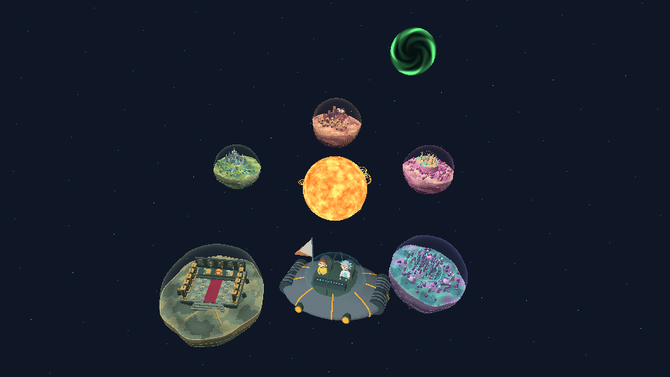
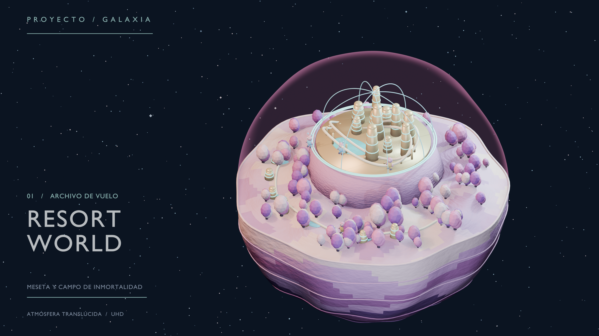
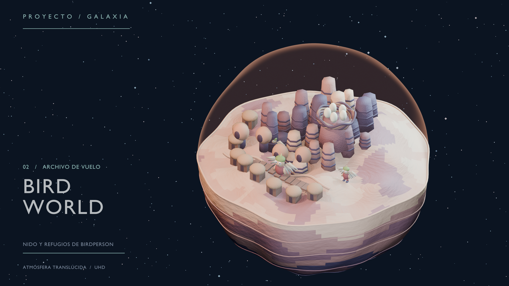
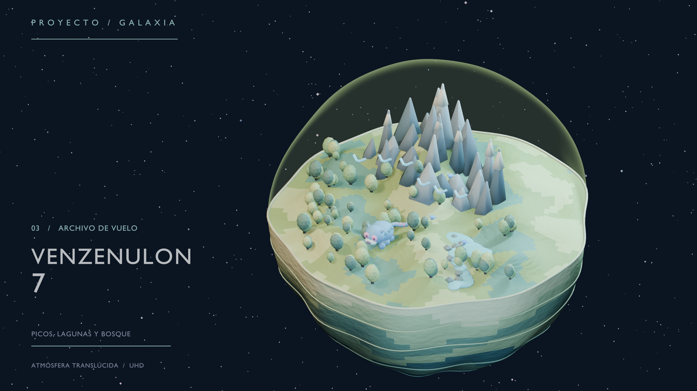
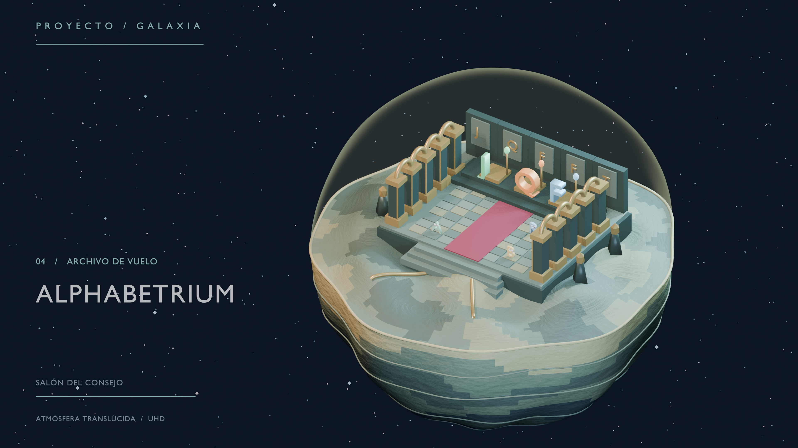
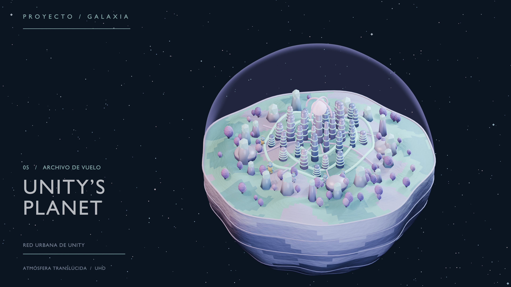
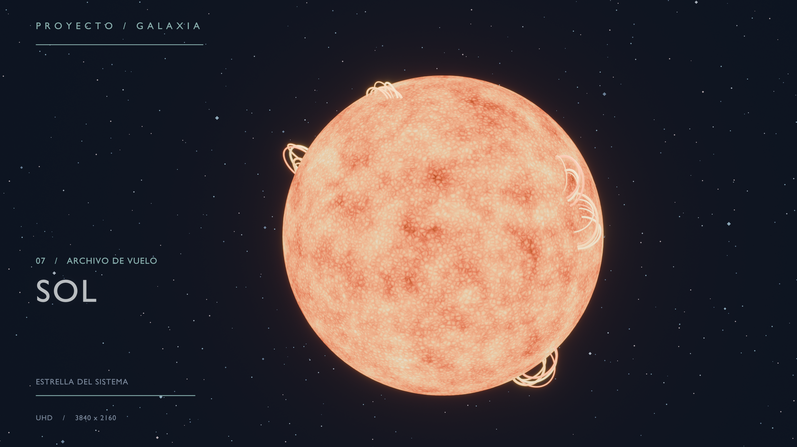
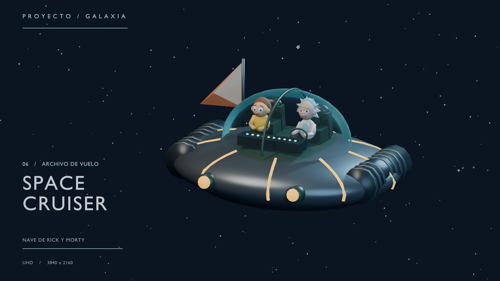
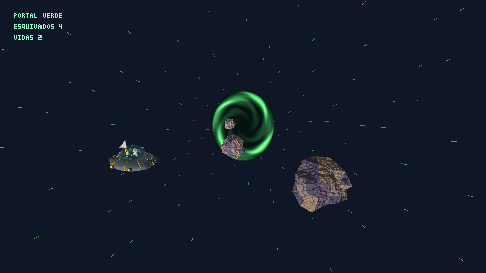

# Proyecto Galaxia

Un sistema solar pequeño y compacto que se explora desde una nave: un sol al centro y cinco mundos grandes de *Rick and Morty* a su alrededor. Las escalas, las órbitas y las partes de la superficie que no aparecen en pantalla son interpretaciones para el proyecto.


## Galería



### Resort World



### Bird World



### Venzenulon 7



### Alphabetrium



### Unity's Planet



### Sol



### Space Cruiser



### Portal Verde



Los renders de los mundos, el sol y la nave están hechos en Blender. Las imágenes de la vista general y del Portal Verde son capturas del juego.

También están el [catálogo con todos los modelos](Modelado/catalogo.jpg) y el [video de demostración](Media/Demostracion.mp4).

## Organización

```
Galaxia Proyecto 3/
├── README.md
├── Simulador/          El juego
│   ├── src/            Código en Rust
│   ├── assets/         Modelos OBJ
│   │   └── audio/      Música
│   ├── bin/            Ejecutable ya compilado
│   └── vendor/raylib/  raylib
├── Modelado/           De dónde salen los modelos
│   ├── generar_blender.py, dioramas.py, habitantes.py
│   ├── Blender/        Archivos .blend editables
│   ├── 4K/             Renders en 3840 × 2160
│   └── catalogo.jpg    Hoja con todos los modelos
└── Media/              Video de demostración y capturas
```

## Ejecutar

Desde la carpeta `Simulador`, en Windows x64:

```
cd Simulador
cargo run --release
```

El comando recompila si hace falta, así que cualquier cambio en el código se ve en esa misma ejecución. 


Las opciones van después de `--`, por ejemplo `cargo run --release -- --fluido`.

| Opción | Qué hace |
| --- | --- |
| `--meteoritos` | Entra directamente al Portal Verde |
| `--fluido` | Resolución 640 × 360, para equipos lentos |
| `--4k` | Vuelo en 3840 × 2160 |
| `--captura` | Guarda `Simulador/Captura.png` |
| `--demo` | Regenera `Media/Demostracion.mp4` (requiere FFmpeg en el PATH) |
| `--probar-control` | Guarda en `Simulador/control.txt` lo que se lee del control durante 10 s |

## Controles

El juego funciona con teclado o con control de PlayStation, sin configurar nada. La pantalla de juego no muestra instrucciones: **Options** o **H** abre el menú con todos los controles, separados por modo, y pausa la simulación.

### Vuelo libre

| Acción | Teclado | Control de PlayStation |
| --- | --- | --- |
| Moverse | W A S D | Stick izquierdo |
| Mirar | Flechas | Stick derecho |
| Subir / bajar | E / Q | R1 / L1 |
| Turbo | Shift | R2 |
| Frenar y flotar contra la gravedad | Espacio | L2 |
| Alabeo | Z / X | Solo teclado |

### Órbita alrededor de un mundo

| Acción | Teclado | Control de PlayStation |
| --- | --- | --- |
| Rodear el mundo | A / D o ← / → | Stick izquierdo o derecho, horizontal |
| Acercarse / alejarse | W / S | Stick izquierdo, vertical |
| Subir / bajar alrededor del mundo | E / Q o ↑ / ↓ | Stick derecho, vertical, o R1 / L1 |
| Ver desde arriba / volver | T | Triángulo |

### En cualquier modo

| Acción | Teclado | Control de PlayStation |
| --- | --- | --- |
| Elegir mundo | 1–5 | Cruceta izquierda / derecha |
| Warp al mundo elegido | F | Cuadrado |
| Entrar / salir de la órbita | Tab | X |
| Mostrar las órbitas | O | Círculo |
| Encender / apagar mapeo de normales | N | L3 |
| Encender / apagar gravedad | G | R3 |
| Menú de instrucciones | H | Options |
| Guardar captura / salir | F2 / Esc | Sin botón |

Si estás lejos de un mundo, Tab o X viajan con warp hasta él. En la órbita, cambiar de mundo también hace warp. Al acercarte a un mundo en vuelo libre, ese mundo pasa a ser el destino y su nombre aparece arriba; cerca del sol dice `SOL`.

La gravedad actúa en vuelo libre. En órbita y durante el warp, la nave se guía sola.

## Recorrido para la demostración

1. Empieza en la vista general: el sol al centro y los cinco mundos alrededor.
2. Pulsa **F** o **Cuadrado** para hacer warp hasta el mundo 1. No hay pantalla de carga ni cambio de escena.
3. Acércate con **W** o el stick izquierdo. La colisión detiene la nave antes de la superficie.
4. Rodéalo con **D**. La distancia no cambia.
5. Pulsa **T** o **Triángulo** para verlo desde arriba.
6. Aléjate con **S**.
7. Pulsa **Tab** o **X** para pasar a vuelo libre. Suelta los controles cerca de un mundo: la gravedad atrae la nave hasta la superficie.
8. Vuela hacia el anillo verde del fondo para entrar al Portal Verde.

`Media/Demostracion.mp4` muestra este recorrido usando la misma física del juego.

## Características del menú y dónde verlas

| Característica | Dónde verla | Código |
| --- | --- | --- |
| 5 mundos distintos que orbitan y rotan | Vista general y teclas 1–5 | `center`, `render` en `main.rs` |
| Modelos propios: árboles, rocas, edificios, monumentos | De cerca, en cada mundo | `Modelado/dioramas.py` |
| Shader de terreno con ruido pegado a la superficie | Cualquier mundo | `Effect::Land` en `main.rs` |
| Shader animado del sol | Sol | `Effect::Sun`, `ruido.rs` |
| Shader de vidrio con borde más opaco | Atmósferas y cabina | `Effect::Glass` |
| Shader animado del portal y túnel de warp | Anillo del fondo y F | `portal_color` en `meteoritos.rs`, `warp_tunnel` |
| Mapeo de normales por píxel | Cualquier mundo de cerca; compara con N o L3 | `normal_map.rs`, `Effect::Land` en `main.rs` |
| Atracción gravitatoria | Suelta los controles cerca de un mundo; compara con G o R3 | `gravity_at` en `main.rs`, `step_free` en `vuelo.rs` |
| Modo local de órbita | Tab o X | `step_orbit` en `vuelo.rs` |
| Aceleración y giro progresivos, independientes de los FPS | Vuelo libre | `step_free` en `vuelo.rs` |
| Colisión que impide atravesar y hace deslizar | Volar contra un mundo o el sol | `safe_move` en `main.rs` |
| Descarte de objetos fuera de la vista | Contador `TRI` al girar la cámara | Inicio de `draw` |
| Niveles de detalle según la distancia, sin que se note el cambio | Contador `TRI` al alejarse | `lod.rs`, `detail` en `main.rs` |

El relieve grande y la distribución de objetos se generan por adelantado en Blender con funciones y una semilla fija (`Modelado/dioramas.py`), no durante el renderizado.

## Pipeline

raylib solo crea la ventana, lee teclado y control, reproduce la música y muestra el framebuffer como una textura 2D (`display.rs`). No se usan sus funciones de dibujo 3D, modelos, cámara, materiales, shaders ni física.

1. `obj_loader.rs` carga los OBJ triangulados.
2. `draw` en `main.rs` transforma de modelo a vista y proyección, descarta por esfera envolvente, descarta caras traseras y recorta contra el plano cercano.
3. `triangle.rs` rasteriza con coordenadas baricéntricas.
4. `framebuffer.rs` hace la prueba de profundidad.
5. Los shaders de fragmentos son funciones de Rust que se ejecutan por píxel en la CPU.

### Niveles de detalle

`lod.rs` genera tres niveles por mundo al iniciar, uniendo los vértices que caen en la misma celda de una rejilla. No se quita ningún objeto a propósito. `detail` usa un nivel solo cuando su celda mide menos de medio píxel en pantalla, por eso el cambio no se nota y depende de la resolución. Un test compara cada cambio de nivel con el propio mundo rotando medio segundo: el cambio debe alterar menos píxeles.

### Mapeo de normales

1. `normal_map.rs` genera un mapa de 256 × 256 al iniciar: alturas con ruido periódico y normales calculadas con diferencias centrales.
2. Por cada cara, `draw` calcula una base tangente y pasa la luz a ese espacio.
3. Por cada píxel, el shader recupera la posición en el objeto con corrección de perspectiva, lee la normal del mapa y calcula la luz con ella.
4. El relieve se desvanece con la distancia para evitar parpadeo.

## Parámetros para cambiar en vivo

Están al inicio de `Simulador/src/main.rs`. Edita el valor y vuelve a correr `cargo run --release`.

| Parámetro | Qué controla |
| --- | --- |
| `PLANET_SCALE` | Tamaño de cada mundo |
| `SUN_SCALE` | Tamaño del sol |
| `ORBIT_RADII` | Distancia de cada mundo al sol |
| `ORBIT_SPEED` | Velocidad orbital |
| `LOD_PIXEL_ERROR` | Error en píxeles permitido al cambiar de nivel de detalle |
| `LOD_CELLS` | Tamaño de celda de cada nivel de detalle |
| `NORMAL_STRENGTH` | Intensidad del mapeo de normales |
| `SURFACE_GRAVITY` | Fuerza de la gravedad |
| `PORTAL_CENTER`, `PORTAL_RADIUS` | Posición y tamaño del portal |

Los mundos comparten velocidad angular, por eso nunca se chocan. Si agrandas mucho un mundo o acercas las órbitas, `cargo test` avisa cuando dos cuerpos se tocan.

La semilla del mapa de normales es `SEED` en `normal_map.rs`. La intensidad de los shaders está en `Effect::Sun` y `Effect::Land`. La semilla de distribución (`random.Random(9710+i)`) y el relieve (`height`) están en `Modelado/dioramas.py`. Para aplicarlos hace falta Blender. Desde la carpeta `Modelado`:

```
blender -b --python generar_blender.py -- --exportar-vuelo
```

`blender -b --python generar_blender.py`, sin más opciones, regenera `Modelado/Blender/` y los PNG de `Modelado/4K/`.

## Música y sonido

- `Rick and Morty Theme.mp3` suena en bucle en el sistema solar. Al volver del portal sigue donde iba.
- `Rick's Backstory Music - Rick & Morty Unreleased Music.mp3` suena dentro del Portal Verde y empieza desde el inicio en cada entrada.

Los MP3 están en `Simulador/assets/audio`. 

## Portal Verde

Es un anillo verde al fondo del sistema: se entra volando a través de él, sin pulsar nada. `cargo run --release -- --meteoritos` entra directamente. Esquiva meteoritos con WASD, las flechas o el stick izquierdo. Tienes tres vidas y cada meteorito esquivado suma un punto. **R** o **X** reinicia al perder, y **P** o **Share** vuelve a la galaxia, frente al portal.

## Recursos externos 

Referencias visuales:

1. [Resort World](https://rickandmorty.fandom.com/wiki/Resort_World) e [Immortality Field Resort](https://rickandmorty.fandom.com/wiki/Immortality_Field_Resort). Meseta, hoteles, cúpula, Whirly Dirly y bosque rosado.
2. [Bird World](https://rickandmorty.fandom.com/wiki/Bird_World). Hogar de Birdperson, con estratos, pilares y un nido.
3. [Venzenulon 7](https://rickandmorty.fandom.com/wiki/Venzenulon_7). Valles verdes, montañas y bandada azul.
4. [Alphabetrium](https://rickandmorty.fandom.com/wiki/Alphabetrium). Salón del consejo con alfombra roja, arcadas doradas y los consejeros J, Q y F.
5. [Unity's Planet](https://rickandmorty.fandom.com/wiki/Unity%27s_Planet). Praderas verde azuladas, vegetación morada y un centro urbano inspirado en la mente colmena.
